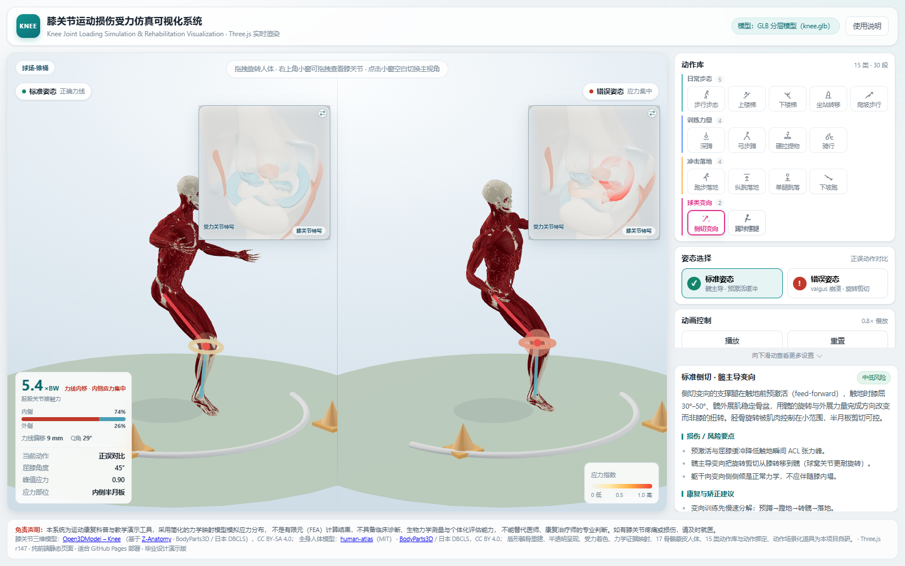
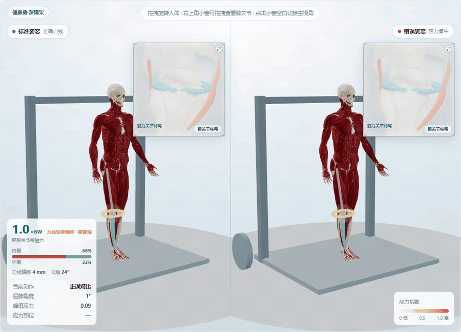
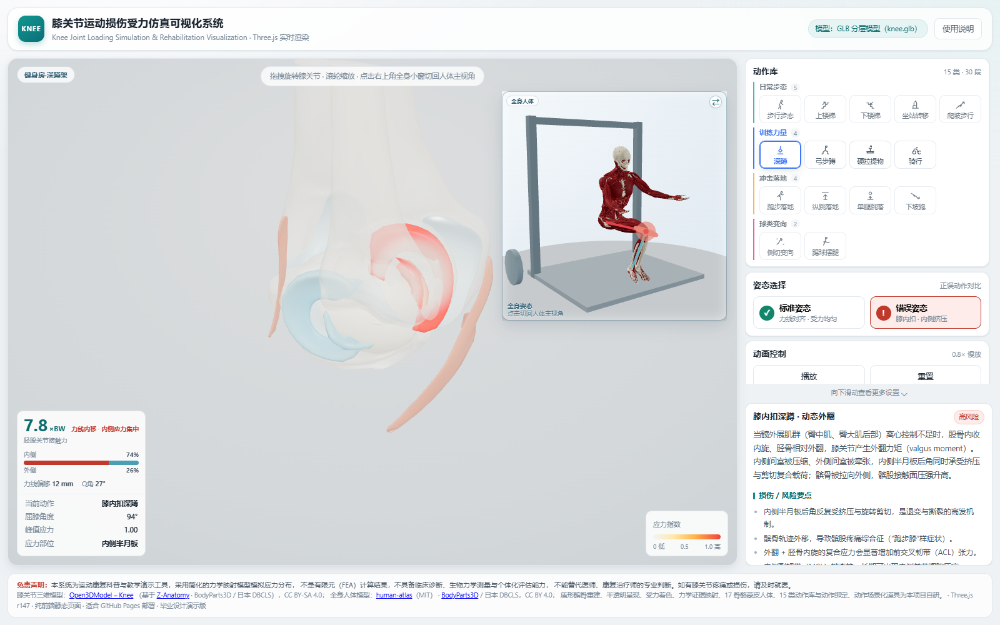
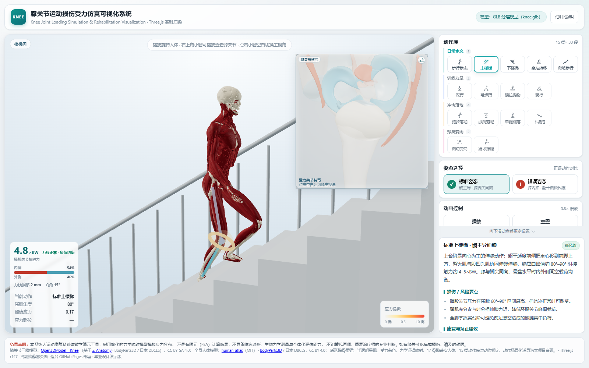
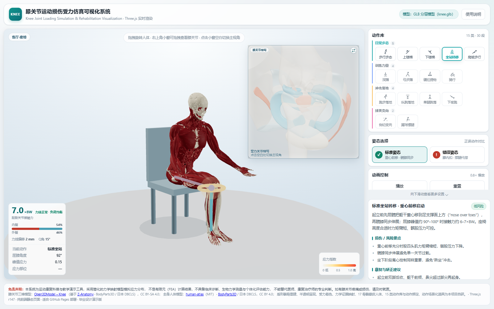
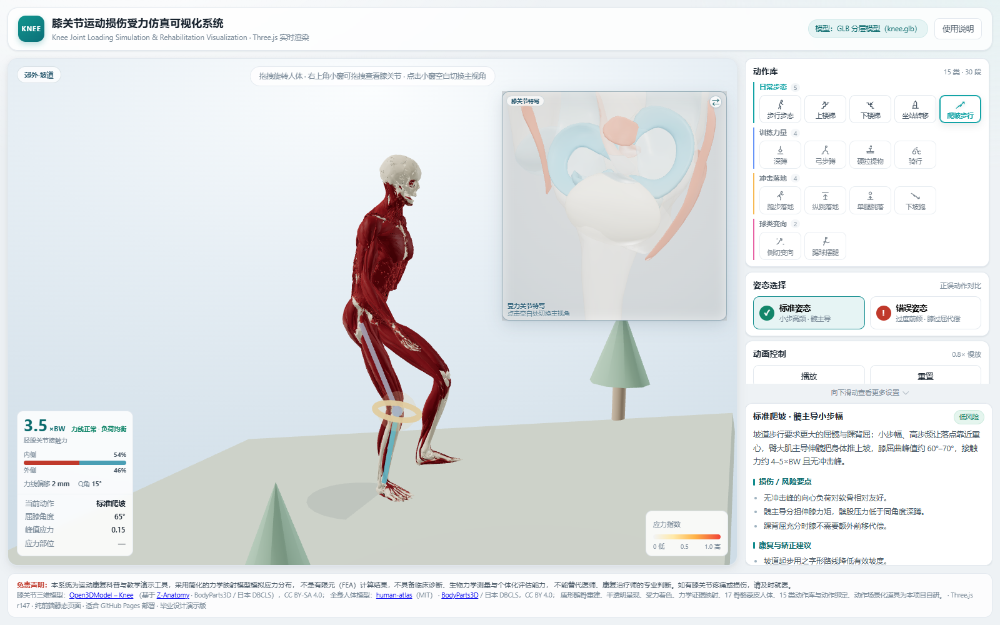
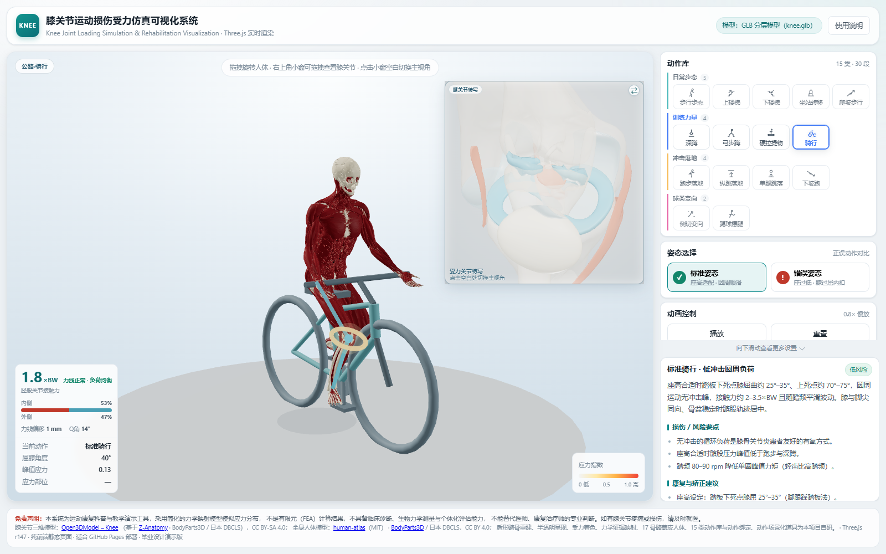
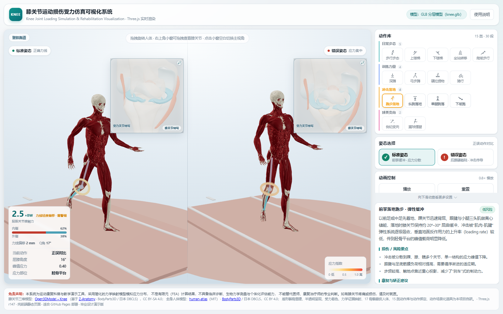
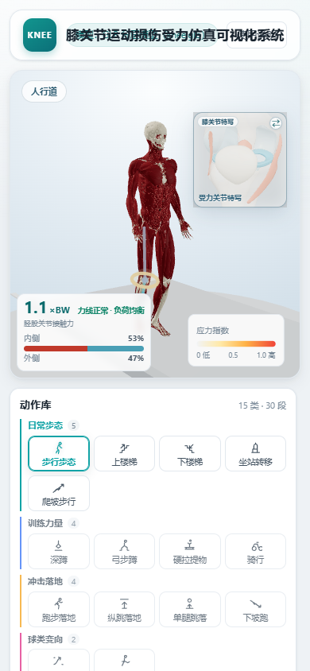

<div align="center">

# 膝关节运动损伤受力仿真可视化系统

**在浏览器里「看见」膝盖为什么会受伤。**

15 类日常 / 运动动作 × 正误对比 · 真实解剖人体 + 18 部件膝关节 · 实时受力热力 + 力学证据读数


**在线体验：** 部署后访问 `https://<你的用户名>.github.io/<仓库名>/`
（纯静态页面，零后端、零构建工具，可直接双击 `index.html` 打开）

</div>



<p align="center">
  
  <br />
  <sub>分屏深蹲演示（GIF）：同一时间轴下，左侧标准姿态受力均匀，右侧膝内扣姿态内侧半月板逐渐变红、力线偏移增大</sub>
</p>

> **English** — An interactive, fully static Three.js (r147) teaching tool that visualizes *why* knee injuries happen. It pairs **15 everyday/sport motions** with **correct-vs-wrong variants (30 clips)**, an écorché human built from BodyParts3D data, an **18-part anatomical knee**, per-part **stress heatmaps**, and **biomechanical readouts** (×BW contact force, medial/lateral compartment load, KAM, Q-angle, force-line offset). One canvas with synchronized split view, physically grounded feet and scene props, desktop + mobile, deploy straight to GitHub Pages. No npm, no build step.

---

## 为什么值得你给一个 Star？

大多数「Three.js 解剖演示」停留在**模型旋转展示**：好看，但不能回答「这个动作为什么会伤」。这个项目把完整因果链做进了一个网页：

> **动作姿态 → 骨骼/肌肉运动学 → 膝关节间室受力 → 带单位的力学证据 → 损伤机制 → 康复建议**

具体来说：

- **30 段动作，不是 1 段循环动画**：15 类动作都有「标准 / 错误」两版完整曲线，可拖时间轴逐帧对照，覆盖步行、上下楼、坐站、爬坡、深蹲、弓步、硬拉、骑行、跑步、跳跃、下坡、侧切、踢球。
- **真实解剖模型**：全身 écorché（623 个 BodyParts3D 源部件 → 单一蒙皮网格、17 骨骼 LBS 蒙皮、约 27 万三角面），膝关节为 18 个独立解剖部件（股骨 / 胫骨 / 腓骨 / 髌骨 / 软骨 / 内外侧半月板含前后角 / ACL·PCL·MCL·LCL）。
- **受力有可视化证据**：错误姿态屈膝到峰值时，内侧半月板与胫骨平台切换为半透红热力着色；同时给出 **×BW 接触力、内/外侧间室分配、力线偏移 mm、Q 角、KAM**，正确与错误一眼可辨、可用数字解释。
- **动作「活在场景里」**：楼梯、坡道、座椅、深蹲架、跑道、骑行车、锥桶、球门等 12 类场景道具；脚掌会随台阶踏步、坡面法向、座椅位置对齐，避免悬空与穿模。
- **工程可复现**：纯前端、无打包、依赖已本地化；单 canvas + scissor 多视口；桌面与移动端都通过回归检查。
- **诚实的技术边界**：明确标注「教学映射，不是有限元、不是临床诊断」——这也是答辩和代码评审时最容易被认可的一点。

### 与常见解剖演示的差别

| 常见 Three.js 解剖演示 | 本项目 |
| --- | --- |
| 单个模型旋转展示 | 15 类动作 × 正误 = 30 段可拖时间轴的完整运动 |
| 固定配色 | 逐部件应力热力 + 风险分级 + 力学读数 |
| 只有「好看」 | 动作 → 受力 → 证据 → 机制 → 建议的完整因果链 |
| 关节与人体各自为政 | 同一进度、同一世界视角，双向实时联动 |
| 人物「浮」在道具旁 | 足底钉地、台阶踏步、坡面法向、坐站离椅等物理约束 |

---

## 一眼看懂功能

| | 能力 | 说明 |
| --- | --- | --- |
| ① | **动作库 15 类 / 30 段** | 日常步态 5 · 训练力量 4 · 冲击落地 4 · 球类变向 2，每类标准 / 错误各一段 |
| ② | **真实人体主画面** | écorché 肌肉 + 骨骼，17 骨骼蒙皮，可拖拽旋转 / 滚轮缩放 / 右键平移 |
| ③ | **膝关节特写小窗** | 18 部件分层模型，可单独显隐 / 调透明度；分屏时左右各一 |
| ④ | **双向视角联动** | 人体与膝关节特写都可拖拽旋转、滚轮缩放，另一侧按同一世界方位**实时跟随** |
| ⑤ | **单视图 / 左右分屏** | 左标准、右错误，进度严格同步；拖动任一侧时间轴两边同步 |
| ⑥ | **主视角对调** | 点击小窗空白处，膝关节特写变主画面，人体缩为右上角小窗，再点切回 |
| ⑦ | **应力热力仿真** | 逐部件应力曲线 0~1 → 黄 / 橙 / 半透红；正确动作全程低于显露阈值 |
| ⑧ | **力学证据层** | 接触力 ×BW、间室载荷占比、负重力线偏移、Q 角、KAM、风险等级 |
| ⑨ | **解剖拾取** | 点击任意部件显示中英文名称与医学简介，选中部件加青色轮廓 |
| ⑩ | **科普联动** | 每个动作 × 每种姿态都有独立原理、损伤风险、康复建议文案 |
| ⑪ | **场景化道具** | 楼梯 / 坡道 / 座椅 / 深蹲架 / 单车 / 跑道 / 跳箱 / 锥桶 / 球门等 |
| ⑫ | **动画控制** | 播放暂停、时间轴拖拽、0.2×~1.6× 变速、重置 |
| ⑬ | **响应式** | 桌面双栏、移动端上下堆叠；触屏拖拽与双指缩放 |
| ⑭ | **兜底不白屏** | GLB 解析失败回退内置分层模型；人体数据失败回退程序化玻璃人 |

---

## 动作库：15 类 × 标准 / 错误

| 分组 | 动作 | 标准姿态 | 错误姿态 | 场景 |
| --- | --- | --- | --- | --- |
| 日常步态 | 步行步态 | 滚动缓冲 · 负荷均衡 | 跨步刹车 · 膝过伸内扣 | 人行道 |
| 日常步态 | 上楼梯 | 髋主导 · 膝脚尖同向 | 膝内扣 · 躯干侧倾代偿 | 楼梯间 |
| 日常步态 | 下楼梯 | 离心控制 · 轻柔触地 | 内扣坠落 · 冲击直传 | 楼梯间 |
| 日常步态 | 坐站转移 | 重心前移 · 髋膝同步 | 膝内扣 · 撑腿代偿 | 客厅 · 座椅 |
| 日常步态 | 爬坡步行 | 小步高频 · 髋主导 | 过度前倾 · 膝过屈代偿 | 郊外 · 坡道 |
| 训练力量 | 深蹲 | 力线对齐 · 受力均匀 | 膝内扣 · 内侧挤压 | 健身房 · 深蹲架 |
| 训练力量 | 弓步蹲 | 前后均衡 · 膝脚尖同向 | 前膝内扣 · 超趾过载 | 健身房 · 垫上 |
| 训练力量 | 硬拉提物 | 髋铰链 · 脊柱中立 | 膝主导 · 内扣圆背 | 健身房 · 举重台 |
| 训练力量 | 骑行 | 座高适配 · 圆周顺滑 | 座过低 · 膝过屈内扣 | 公路 · 骑行 |
| 冲击落地 | 跑步落地 | 前掌缓冲 · 应力分散 | 后跟硬着陆 · 冲击传导 | 塑胶跑道 |
| 冲击落地 | 纵跳落地 | 髋膝踝三重缓冲 | 膝内扣硬落 · 冲击直传 | 健身房 · 跳箱 |
| 冲击落地 | 单腿跳落 | 单侧缓冲 · 骨盆稳定 | 内扣坠落 · 单侧过载 | 健身房 · 跳箱 |
| 冲击落地 | 下坡跑 | 小步高频 · 离心缓冲 | 跨步刹车 · 膝过伸冲击 | 郊外 · 坡道 |
| 球类变向 | 侧切变向 | 髋主导 · 预激活缓冲 | valgus 崩溃 · 旋转剪切 | 球场 · 锥桶 |
| 球类变向 | 踢球摆腿 | 支撑微屈 · 摆腿鞭打 | 支撑膝过伸 · 冲击锁死 | 球场 · 球门 |

### 截图

| 膝关节受力特写（错误深蹲峰值） | 上楼梯：台阶踏步对齐 |
| --- | --- |
|  |  |

| 坐站转移：脚掌固定、身体移出椅面 | 爬坡步行：髋主导的小步高频 |
| --- | --- |
|  |  |

| 骑行：座高与脚踏圆周 | 跑步分屏：标准 vs 后跟硬着陆 |
| --- | --- |
|  |  |

| 移动端（390 px） | |
| --- | --- |
|  | 竖屏自动堆叠：画布 + 动作库 + 参数面板，触屏可旋转 / 缩放 |

---

## 力学模型：用「证据」而不是「动画」说话

<details open>
<summary><b>① 应力热力（stressShader.js）</b></summary>

- 每段动作在 `motions.js` 中为 `meniscus_medial / meniscus_lateral / tibia_plateau` 等部件定义 0~1 的应力-时间曲线；
- 着色器按应力值把材质颜色推向黄 → 橙 → 半透红，并叠加菲涅尔边缘光；
- 正确姿态的曲线全程 < 0.25（不显红），错误姿态在峰值到 1.0；
- 热力可一键关闭，用于答辩时演示「红色消失 → 正确姿态」。

</details>

<details open>
<summary><b>② 生物力学读数（biomech.js）</b></summary>

| 指标 | 含义 | 教学锚点 |
| --- | --- | --- |
| 胫股关节接触力 | 以体重倍数 `×BW` 表示 | 步行 2–3×BW、深蹲约 7×BW、跑步 3–8×BW（J Biomech 2016） |
| 内 / 外侧间室分配 | 内、外侧平台载荷百分比 | 正常接近 50∶50；动态膝外翻时内侧升高 |
| 负重力线偏移 | 重力线相对膝中心的水平位移（mm） | 内扣越深偏移越大，面板同步给出风险等级 |
| Q 角 | 股四头肌力线与髌腱夹角 | 男 10–15°、女 15–20°，>20° 需关注 |
| KAM | 膝内收力矩（N·m/kg） | 内侧间室压缩的公认代理指标 |

接触力按屈膝角指数上升，落地冲击另叠加独立冲击项——这样能表达「后跟硬着陆：屈膝很小、几乎没有缓冲，却承受全量冲击」这一关键机制。

**边界**：这些数值是依据公开文献量级做的**教学映射**，不是有限元求解、不是个体化测量，不能用于诊断。

</details>

<details open>
<summary><b>③ 物理落地与防穿模</b></summary>

- 步行 / 跑 / 跳：足底 IK 钉地，骨盆高度随支撑腿可达范围回落，避免「飘在空中」；
- 楼梯：脚掌目标点取自踏步高度与踏面位置，保证脚踩在台阶上而不是悬空；
- 坡道：脚踝目标沿坡面法向抬升，落地角度随坡度倾斜；
- 坐站：脚掌固定在座椅前方，身体沿 `rootZ` 曲线前移离开椅面；臀部最低点始终高于座面；
- 自行车：脚踝沿脚踏圆周运动，座高与膝屈曲角匹配。

</details>

---

## 系统设计

```
                       ┌──────────────────────────────┐
                       │          index.html          │
                       └──────────────┬───────────────┘
                                      │ 单 canvas + scissor 视口
        ┌─────────────────────────────┼─────────────────────────────┐
        │                             │                             │
  膝关节主画面                 膝关节小窗 / 全身主画面          右上角小窗
  (views[0/1])                 (bodyViews[0/1])               (可对调)
        │                             │                             │
        └─────────── 同一归一化进度 t ─┴────────── 同一世界视角 ─────┘
                                      │
               motions.js（30 段动作唯一数据源：关节轨道 / 应力曲线 /
               全身姿态曲线 / 力学锚点 / 科普文案 / 场景名）
```

| 模块 | 职责 |
| --- | --- |
| `js/motions.js` | **唯一数据源**：15 类动作 × 正误 = 30 段 clip（膝轨道、应力、全身姿态、力学 profile、文案、场景） |
| `js/sceneKit.js` | 15 类场景道具与地面采样（楼梯链、坡面、座椅、单车、跑道、锥桶…），供脚部 IK 对齐 |
| `js/bodyFigure.js` | 全身 écorché 人体：17 骨骼蒙皮、姿态曲线、腿IK、钉地、坐站/台阶/坡面约束 |
| `js/animationCtrl.js` | 膝关节动画：GLB clip 优先、缺失时按曲线合成；正误分屏同步 |
| `js/stressShader.js` | 逐部件热力材质与应力采样 |
| `js/biomech.js` | ×BW / 间室分配 / 力线 / Q 角 / KAM / 风险分级 |
| `js/modelLoader.js` | GLB 加载与分层解析；失败回退程序化膝关节模型 |
| `js/rayPick.js` | 分视口 NDC 换算、部件拾取、青色轮廓 |
| `js/uiCtrl.js` | 面板 / 目录 / 文案 / 读数绑定 |
| `js/main.js` | 场景、相机、灯光、布局、双轨道控制器联动、主循环 |
| `assets/models/` | `knee.glb`（18 部件）+ `human.json/bin`（17 骨骼蒙皮人体）+ 内嵌兜底副本 |
| `tools/build_human_from_atlas.mjs` | 从 human-atlas 公开数据重建蒙皮人体的离线脚本 |

### 几个实现细节

- **一个 canvas，多视口**：分屏与画中画都用 `setViewport/setScissor`，不复制 canvas，天然共享事件与时间轴；
- **视角联动**：人体与膝关节各有一套 `OrbitControls`，按指针所在视口路由；被动侧以「世界方位角/俯仰角增量」跟随，缩放距离各自保留；
- **渲染与 DOM 对齐**：小窗边框是 DOM 浮层，像素坐标与 scissor 视口一一对应，支持任意窗口尺寸与 DPR；
- **缓存与离线**：所有脚本带版本号查询串；Three.js 依赖已本地化，`.nojekyll` 已加入仓库。

---

## 快速开始

```bash
# 方式 A：任意静态服务器（推荐）
python -m http.server 8080
# 或 npx serve .
# 打开 http://127.0.0.1:8080

# 方式 B：直接双击 index.html
# 新版 Chrome / Edge 可直接加载；若浏览器限制本地文件读取，
# 会自动回退到内嵌数据（human-data.js / knee-data.js），页面不会白屏。
```

无需 `npm install`、无需打包、无需后端。

### 操作

| 操作 | 效果 |
| --- | --- |
| 左键拖拽 | 旋转当前视口（人体或膝关节） |
| 滚轮 / 双指捏合 | 缩放当前视口；两个视角缩放互相独立 |
| 右键拖拽 | 平移人体视口（膝关节视口不支持平移） |
| 点击解剖部件 | 显示名称与医学简介 |
| 点击小窗空白处 | 对调主画面（人体 ⇄ 膝关节），再点切回 |
| 空格 | 播放 / 暂停 |
| 时间轴拖拽 | 逐帧查看任意动作 |

### 3 分钟演示脚本（课程汇报 / 答辩可直接用）

1. **标准深蹲**：单视图拖时间轴到最低点，指出力线穿过膝中心、内外侧 55∶45、无红色——正确动作不是「零负荷」，而是负荷均匀；
2. **切到错误姿态**：同一时间点，内侧半月板变红、力线偏移增加到 12 mm、内侧载荷 74%，KAM 升高——解释「膝内扣为什么伤内侧」；
3. **切分屏**：左右同进度对比，说明错误姿态冲击直传、缺少离心缓冲；
4. **换到上楼梯 / 坐站**：展示脚掌踩在踏步上、起身时身体离开椅面——强调这不是「贴图动画」，而是带物理约束的程序化姿态；
5. **点击小窗空白**：膝关节特写变主画面，拖动旋转并展示人体小窗同步跟随——说明 18 部件分层模型与双视角联动。

---

## 部署到 GitHub Pages

```bash
git init
git add .
git commit -m "feat: knee loading simulation"
git branch -M main
git remote add origin https://github.com/<你的用户名>/<仓库名>.git
git push -u origin main
```

1. 仓库 **Settings → Pages**；
2. Source 选 **Deploy from a branch**，分支 `main`，目录 `/ (root)`，保存；
3. 1–2 分钟后访问 `https://<你的用户名>.github.io/<仓库名>/`。

已处理好的部署细节：

- 所有资源使用**相对路径**，放在任意子路径都能工作；
- 仓库根目录含 **`.nojekyll`**，避免 Jekyll 处理静态资源；
- Three.js 依赖随仓库提供，**不依赖外网 CDN**（校园网 / 离线演示也稳定）；
- `index.html` 使用带版本号的查询串，更新后强制刷新即可看到新版本。

**建议顺手补充的仓库信息（有利于被发现和 Star）**

- Description：`浏览器里的膝关节运动损伤仿真：15 类动作 × 正误对比，真实解剖人体 + 膝关节应力热力 + 力学证据读数 · Three.js`
- Topics：`threejs` `webgl` `biomechanics` `knee` `rehabilitation` `anatomy` `visualization` `education` `static-site` `github-pages`
- 勾选 **Releases** 打一个 `v1.0.0` 标签，README 顶部再放一张在线体验截图。

---

## 扩展指南

| 想做的事 | 改哪里 |
| --- | --- |
| 新增 / 修改动作 | `js/motions.js`：仿照现有条目填 `knee / stress / profile / body / info`，再加入 `MODES` 与 `GROUPS`，目录、读数、文案、场景 badge 自动接入 |
| 替换膝关节模型 | 覆盖 `assets/models/knee.glb`（节点名保持 `FemurPivot / TibiaPivot / PatellaPivot / KneeRoot`），或触发内置兜底模型 |
| 换全身人体 | 用 `tools/build_human_from_atlas.mjs` 重新烘焙 `human.json / human.bin`（17 骨骼命名不变） |
| 加场景道具 / 地面 | `js/sceneKit.js`：新增 kit 的 `get(mode)` 与地面采样函数 |
| 调力学量级 | `js/biomech.js` 与 `motions.js` 的 `profile`（`forceAt90 / shiftBase / medialBase / valgus / impact`） |

更完整的模型替换、Blender 动画命名约定与部署注意事项，见页面内「使用说明」弹窗。

---

## 工程与验证

开发期使用外部 Puppeteer 冒烟脚本做回归（脚本不随仓库分发，依赖本机 Edge）：

| 检查项 | 结果 |
| --- | --- |
| 功能回归（模型、30 clip、目录、分屏同步、拾取、热力、移动端） | **19 / 19 通过** |
| 视角对调 / 小窗切换（桌面 + 移动端） | **10 / 10 通过** |
| 30 段动画注册到 mixer | **30 / 30** |
| 15 类模式正误切换、文案、应力、力学读数 | 全部通过 |
| `file://` 直接打开（含 GLB 与蒙皮人体） | 通过，无页面错误 |
| 移动端 | 无横向溢出、无运行时错误 |
| 帧率（1440×900，Edge 无头，单 canvas 双视口） | ~144 fps |

浏览器要求：支持 WebGL 的现代 Chrome / Edge / Safari / Firefox。

---

## 项目结构

```
A运动项目/
├── index.html                     # 单页应用入口（依赖顺序不可随意调整）
├── .nojekyll                      # GitHub Pages 静态资源
├── LICENSE                        # 代码 MIT
├── README.md
├── css/
│   └── style.css                  # 全部样式（浅色临床风格 + 响应式）
├── js/
│   ├── motions.js                 # 30 段动作唯一数据源
│   ├── sceneKit.js                # 场景道具 + 地面/踏步/坡面采样
│   ├── bodyFigure.js              # 全身 écorché 人体与 IK
│   ├── animationCtrl.js           # 膝关节动画与同步
│   ├── stressShader.js            # 应力热力着色
│   ├── biomech.js                 # 力学证据读数
│   ├── modelLoader.js             # GLB 加载 / 分层 / 兜底
│   ├── rayPick.js                 # 多视口拾取
│   ├── uiCtrl.js                  # 面板与科普文案
│   ├── main.js                    # 场景、相机、布局、渲染主循环
│   ├── embed.js
│   └── vendor/                    # Three.js r147 本地副本
├── assets/models/
│   ├── knee.glb                   # 18 部件膝关节（含动画骨架）
│   ├── human.json / human.bin     # 17 骨骼蒙皮 écorché 人体
│   ├── human-data.js / knee-data.js # 内嵌兜底副本
│   └── README.txt                 # 模型节点命名与替换说明
├── docs/screenshots/              # README 截图
└── tools/
    └── build_human_from_atlas.mjs # 人体资产离线构建脚本
```

---

## 已知边界与路线图

**边界（也是设计的一部分）**

- 应力分布是逐部件教学映射，不是有限元（FEA）求解，不能预测个体组织损伤；
- 力学读数为文献量级锚点，不构成临床诊断或康复处方；
- 全身人体与膝关节是两套独立模型，同步的是动作进度与观察视角，不是同一套网格的解剖拼接。

**路线图**

- [ ] 把 `motions.js` 的曲线导出为 JSON schema，开放第三方动作包；
- [ ] 增加画中画分屏拖动位置记忆与自定义布局；
- [ ] 录制 / 导出一段动作的确定性截图序列（用于论文图）；
- [ ] 中英双语界面与无障碍字幕；
- [ ] 更多动作：篮球落地、羽毛球跨步、椭圆机、上下公交台阶。

如果你希望某个功能优先做，欢迎开 Issue。

---

## 许可与署名

| 资源 | 来源 | 许可 |
| --- | --- | --- |
| 本项目源代码（HTML / CSS / JS / 工具脚本） | 本仓库作者 | **MIT**（见 `LICENSE`） |
| 膝关节模型几何 `knee.glb` | [Open3DModel – Knee](https://anatomytool.org/content/open3dmodel-knee-english-labels)（基于 [Z-Anatomy](https://www.z-anatomy.com) / BodyParts3D / 日本 DBCLS） | **CC BY-SA 4.0**（衍生模型同许可共享） |
| 全身人体网格 `human.json/bin` | [ashemag/human-atlas](https://github.com/ashemag/human-atlas) · [BodyParts3D](https://bodyparts3d.jp) / DBCLS | MIT（代码）· **CC BY 4.0**（几何） |
| Three.js | three.js 项目 | MIT |

本项目自行完成：盾形髌骨重建、模型归一化与半透明呈现、受力热力着色、力学证据映射、17 骨骼蒙皮人体、15 类动作库与动作绑定、场景化道具、视角双向联动与渲染布局。

再次强调：**本项目仅用于运动康复科普与教学演示，不能替代医师或康复治疗师的专业判断。**

---

<div align="center">

**如果这个项目帮你理解了「膝盖为什么会伤」，或者给你的课程 / 毕设提供了思路，欢迎点一个 Star。**

问题、建议、动作包投稿都欢迎开 Issue / PR。

</div>
